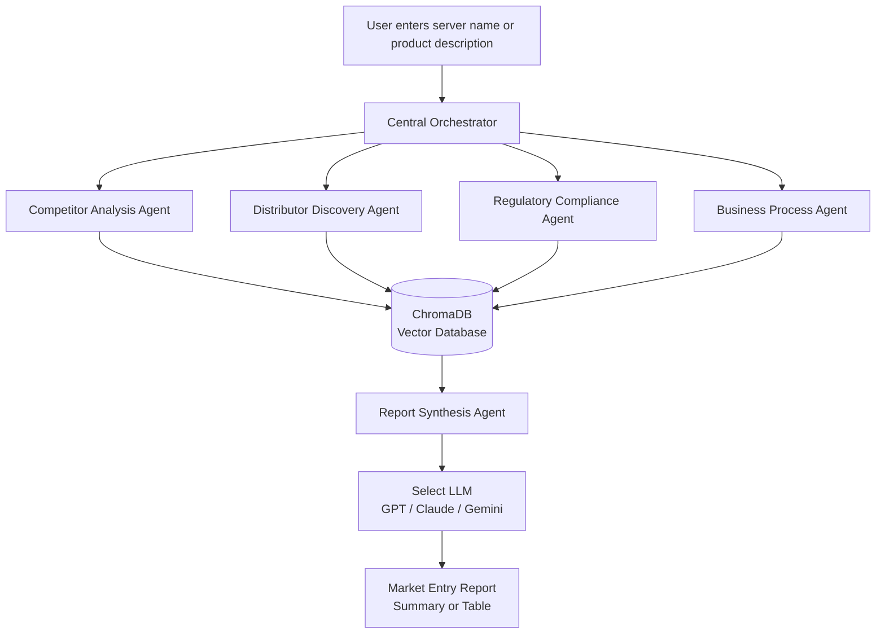

# AI-Powered Market Entry Analysis System

**A multi-agent AI system that helps businesses research a new market, identify opportunities, and plan their product launch.**

Developed as part of my MSc Advanced Computer Science dissertation at Oxford Brookes University, this project explores how Large Language Models (LLMs), Retrieval-Augmented Generation (RAG), and multi-agent orchestration can be combined to solve a practical business problem.

Imagine a company wants to launch an enterprise server in the UK. Before entering the market, it needs to understand its competitors, identify potential distributors, investigate regulatory requirements, and work out how to approach the launch.

Instead of researching each area separately, users can enter their server name or product description into this system and receive a consolidated market-entry report generated from research gathered by five specialised AI agents.

## At a Glance

| Component | Description |
|---|---|
| Architecture | Five specialised agents coordinated by an orchestrator |
| Research | External web search and company data |
| Retrieval | RAG with ChromaDB vector storage |
| AI models | GPT, Claude and Gemini |
| Output | Consolidated market-entry reports, including summaries and tables |
| Evaluation | LLM output comparison and execution-time benchmarking |

## How the System Works

The system divides market-entry research into four specialised tasks. A central orchestrator coordinates the research agents, and a fifth agent combines their findings into a report.

### System Architecture

### The Five Agents

**1. Competitor Analysis Agent — Understanding the competition**

This agent uses Tavily to search the web for information about competitors relevant to the enterprise server being considered. It helps the company understand the existing market landscape using retrieved information rather than relying solely on an LLM's pretrained knowledge.

**2. Distributor Discovery Agent — Finding potential distribution partners**

Entering a new market often requires suitable distribution partners. This agent uses Companies House data to support business discovery, helping identify potential companies that could be relevant to the product's route to market.

**3. Regulatory Compliance Agent — Investigating requirements**

Before launching a product, a company needs to understand the regulatory and compliance requirements that may apply. This agent researches relevant requirements to help identify issues that should be considered during market-entry planning.

**4. Business Process Agent — Planning the launch**

Research alone is not enough; a company also needs a practical way forward. This agent develops a proposed business process for entering the UK market, helping turn the research into a sequence of steps that the company can consider.

**5. Report Synthesis Agent — Turning research into a decision-support report**

Each of the four research agents stores its findings in ChromaDB, a vector database. The report synthesis agent queries this stored information and retrieves relevant findings to build a consolidated report.

Users can select GPT, Claude or Gemini for report generation and compare the models' outputs. They can also request different presentation formats, including a concise summary or a table, depending on the information they need.

## Retrieval-Augmented Generation (RAG)

A key part of the system is the use of Retrieval-Augmented Generation. Rather than asking a language model to answer the entire market-entry question from its existing knowledge, the system first gathers information through its research agents and stores their findings in ChromaDB.

The report synthesis agent then retrieves relevant information from this stored research to inform the final response.

This approach helps ground the generated report in the information gathered during the research process. It can reduce the risk of unsupported claims, although it does not eliminate hallucinations or guarantee that every retrieved fact is correct.

## Evaluation and Results

The project was evaluated in two areas: execution performance and differences in the outputs generated by different LLMs.

### 1. Execution Performance

The execution time was compared between running the agents sequentially, without the orchestrator, and running them concurrently under orchestration.

| Approach | Measured execution time |
|---|---:|
| Sequential agent execution | 90 seconds |
| Concurrent execution with orchestrator | 28 seconds |
| Time saved per run | 62 seconds |

**Result: approximately 68.9% lower execution time** in the tested concurrent workflow compared with sequential execution.

The measured execution time fell from 90 seconds to 28 seconds, demonstrating the potential performance benefit of coordinating independent research tasks concurrently.

### 2. LLM Output Comparison

The system was also tested with GPT, Claude and Gemini to examine differences in the generated market-entry reports.

- **Claude:** Produced the densest outputs, with more detailed responses.
- **Gemini:** Produced the least dense outputs, with more concise responses.
- **GPT:** Was included in the comparison and serves as the default report-generation model.

This comparison highlighted how the choice of LLM can affect the detail and presentation of generated reports, even when the models are working with research gathered by the same system.

These findings describe the observed results from the tested configuration; they should not be interpreted as a universal ranking of the models.

## Technology Stack

- **Python** — Core implementation.
- **LangGraph** — Agent workflow orchestration, where used in the implementation.
- **LangChain** — LLM and retrieval integration, where used in the implementation.
- **ChromaDB** — Vector database for storing and retrieving research findings.
- **Retrieval-Augmented Generation (RAG)** — Approach used to ground report generation in retrieved information.
- **Tavily** — Web search for competitor and market research.
- **Companies House** — Company information used in distributor discovery.
- **OpenAI GPT, Anthropic Claude and Google Gemini** — Language models used for report generation and comparison.

## Security and Limitations

API credentials should be supplied through environment configuration rather than hardcoded into the source code. Secret files, local vector-store data and generated outputs should remain excluded from version control where they contain sensitive or machine-specific information.

The system also has practical limitations. Research quality depends on the relevance and availability of external sources, and retrieved information may be incomplete or outdated. LLM-generated reports can still contain errors, so regulatory findings and business recommendations should be independently verified before being used for real-world decisions.

## What This Project Demonstrates

This project brings together several practical AI engineering concepts:

- Designing a multi-agent architecture for a complex business problem.
- Coordinating independent research tasks through an orchestrator.
- Integrating external information sources into an LLM workflow.
- Using vector storage and retrieval to support RAG.
- Integrating and comparing multiple LLM providers.
- Evaluating execution performance and differences in generated outputs.

**Academic context:** MSc Advanced Computer Science, Oxford Brookes University.